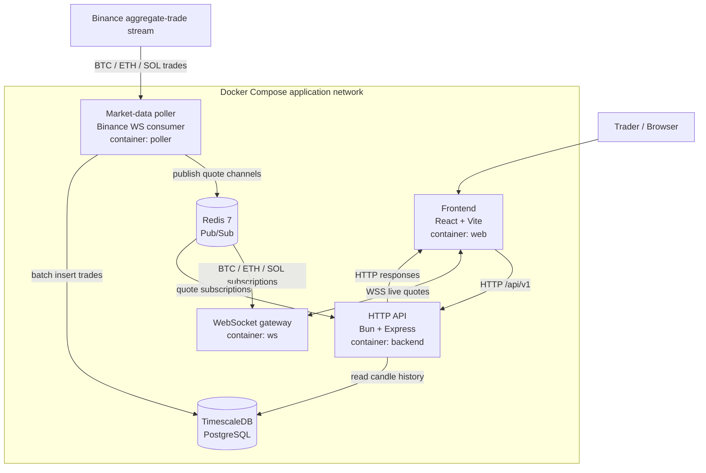
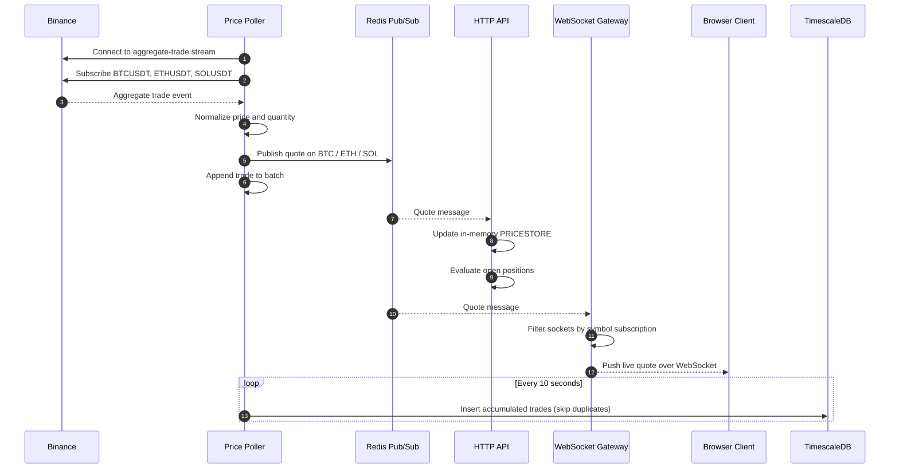
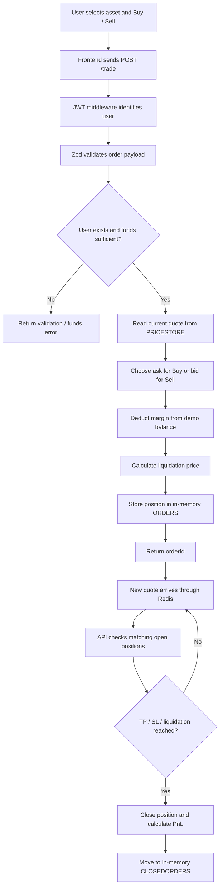
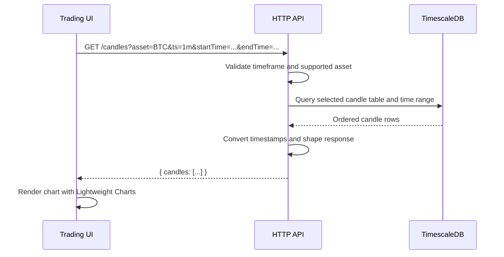
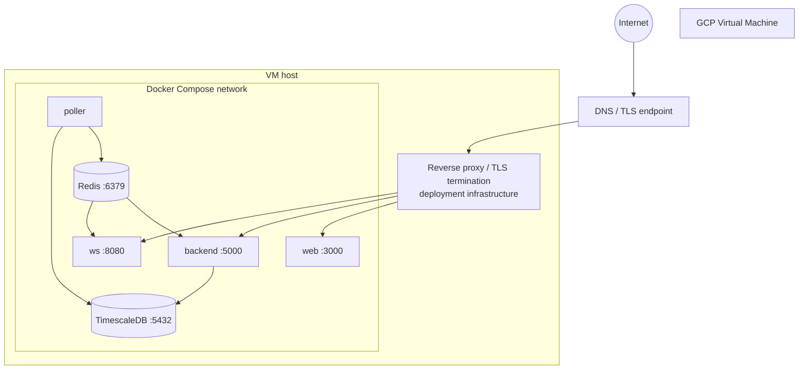

# Exness — Real-Time Crypto CFD Trading Simulator

A containerized trading simulator for BTC, ETH, and SOL markets. It combines a React trading interface, an Express API, a Binance market-data ingestor, Redis Pub/Sub, WebSockets, and TimescaleDB-backed trade history.

> **Project status:** Educational/demo trading platform. The repository implements a simulated trading environment and a demo balance; it is not a brokerage, exchange, or financial product. It should not be used for real-money trading.

<p align="center">
  <a href="https://exness.elevenai.xyz/">Live demo</a> ·
  <a href="https://github.com/AkarshSahlot/Exness">Source code</a>
</p>

---

## Contents

- [Overview](#overview)
- [Features](#features)
- [Technology stack](#technology-stack)
- [System architecture](#system-architecture)
- [Service responsibilities](#service-responsibilities)
- [Real-time market-data flow](#real-time-market-data-flow)
- [Trade lifecycle](#trade-lifecycle)
- [Historical chart-data flow](#historical-chart-data-flow)
- [Data model and storage](#data-model-and-storage)
- [Repository layout](#repository-layout)
- [Run locally](#run-locally)
- [Configuration](#configuration)
- [Service endpoints and ports](#service-endpoints-and-ports)
- [Deployment](#deployment)
- [Engineering notes and limitations](#engineering-notes-and-limitations)

## Overview

Exness simulates a leveraged crypto CFD trading experience. Users can create an account, receive a demo balance, view BTC/USDT, ETH/USDT, and SOL/USDT market prices, open buy/sell positions, and manage positions with take-profit and stop-loss levels.

The application is split into independently containerized services. Market data is ingested separately from user-facing HTTP requests. Redis acts as the real-time message broker, while TimescaleDB (PostgreSQL) stores trade observations used by the historical-data layer.

## Features

- **Demo accounts:** signup/signin flow and a demo starting balance of $5,000.
- **Market coverage:** BTC, ETH, and SOL against USDT.
- **Live price distribution:** Binance aggregate-trade stream → price poller → Redis Pub/Sub → WebSocket clients.
- **Trading UI:** market chart, bid/ask view, buy/sell panel, and open/closed order panels.
- **Position controls:** margin, leverage, take-profit, stop-loss, manual close, and liquidation-price calculation.
- **Historical data:** candle queries for 1-minute, 1-day, and 1-week intervals.
- **Containerized runtime:** Docker Compose orchestrates the frontend, API, poller, WebSocket gateway, Redis, and TimescaleDB.

## Technology stack

| Area | Technologies |
|---|---|
| Frontend | React 19, TypeScript, Vite, Axios, Lightweight Charts, Tailwind CSS |
| HTTP API | Bun, TypeScript, Express 5, Zod, JWT |
| Real-time transport | WebSocket (`ws`) |
| Message broker | Redis 7 Pub/Sub |
| Market-data source | Binance WebSocket aggregate-trade stream |
| Database | TimescaleDB (PostgreSQL 16), Prisma |
| Runtime / orchestration | Docker, Docker Compose |
| Deployment | GCP VM (project deployment) |

## System architecture

The application has two main data paths:

1. **Command/query path:** the browser makes HTTP requests to the API for authentication, asset metadata, orders, and historical candles.
2. **Streaming path:** the poller consumes external market events, publishes normalized quote messages to Redis, and the WebSocket service fans those messages out to subscribed browser sessions. The API also consumes Redis quote updates to refresh its in-memory price store and evaluate open positions.

### High-level architecture



### Runtime service map

| Service | Compose service | Container name | Internal port | Purpose |
|---|---|---|---:|---|
| Frontend | `web` | `web` | 3000 | Serves the React application |
| HTTP API | `backend` | `backend` | 5000 | Authentication, assets, trades, candles |
| Price poller | `poller` | `poller` | — | Consumes Binance stream, publishes quotes, batches trade writes |
| WebSocket gateway | `ws` | `ws` | 8080 | Redis-to-browser live quote fan-out |
| Redis | `redis` | `redis_service` | 6379 | Pub/Sub broker |
| TimescaleDB | `db` | `timescale_db` | 5432 | PostgreSQL-compatible time-series storage |

All services join the `exness-network` Compose network and communicate using service/container DNS names. The Compose file maps the web, API, WebSocket, and database ports to `127.0.0.1` on the host. Redis is not published to the host.

## Service responsibilities

### 1. Frontend

The frontend is a React + TypeScript single-page application. Its main routes are:

- `/` — landing page
- `/signup` — account creation
- `/signin` — login
- `/trading` — trading workspace

The trading workspace combines the market selector, live bid/ask table, candlestick chart, order panel, and buy/sell controls. HTTP calls are centralized in `frontend/src/api/trade.ts`.

### 2. HTTP API

The API is an Express application running under Bun. Routes are mounted below `/api/v1`:

| Route | Responsibility |
|---|---|
| `POST /user/signup` | Create a demo user |
| `POST /user/signin` | Validate credentials and issue a JWT |
| `GET /user/balance` | Read the authenticated user's demo balance |
| `GET /asset` | Return supported asset metadata and current in-memory bid/ask values |
| `POST /trade` | Open a buy/sell position |
| `POST /trade/close` | Manually close an open position |
| `GET /trades/open` | List open positions |
| `GET /trades` | List closed positions |
| `GET /candles?asset=BTC&ts=1m&startTime=...&endTime=...` | Query historical candles |

Authenticated routes use the user middleware to obtain the user ID from the authorization token. Request payloads for signup/signin and trade creation are validated with Zod schemas.

### 3. Price poller

The poller connects to Binance's WebSocket stream and subscribes to:

- `btcusdt@aggTrade`
- `ethusdt@aggTrade`
- `solusdt@aggTrade`

For each aggregate-trade event it:
1. Converts price and quantity into the application's internal numeric representation.
2. Derives a simulated bid/ask quote.
3. Publishes the quote to a Redis channel named `BTC`, `ETH`, or `SOL`.
4. Adds the trade to an in-memory batch.
5. Flushes the batch to the database every 10 seconds using Prisma `createMany` with duplicate skipping.

### 4. WebSocket gateway

The WebSocket service subscribes to the Redis channels `BTC`, `ETH`, and `SOL`. A browser client can send a JSON subscription message:

```json
{ "type": "SUBSCRIBE", "symbol": "BTC" }
```

To stop receiving that market:

```json
{ "type": "UNSUBSCRIBE", "symbol": "BTC" }
```

The gateway tracks each connected socket's symbol subscriptions and forwards a Redis message only to sockets subscribed to that symbol.

### 5. Redis

Redis is used as a lightweight publish/subscribe layer, decoupling the external price producer from the WebSocket gateway and the HTTP API's live-price consumer.

Channels currently used: `BTC`, `ETH`, and `SOL`.

### 6. TimescaleDB

TimescaleDB provides PostgreSQL-compatible storage for raw trade observations and the candle tables queried by the HTTP API. Prisma is used by the poller for batched trade inserts; the API uses the `pg` client for candle queries.

## Real-time market-data flow

This is the core streaming pipeline.



**Why Redis sits in the middle:** the poller does not need to know which browser sessions are connected. It publishes a quote once; the WebSocket gateway handles fan-out to interested clients. The API independently consumes the same quote channels for its price cache and position checks.

## Trade lifecycle

A position is opened through the HTTP API. The current implementation keeps user accounts and open/closed order collections in process memory; the trade-observation records are persisted separately in TimescaleDB.



### Order pricing and risk checks

- Buy positions use the current **ask** price as the opening price.
- Sell positions use the current **bid** price as the opening price.
- The API calculates a liquidation threshold from opening price and leverage.
- Incoming quote updates are checked against take-profit, stop-loss, and liquidation thresholds.
- Positions can also be closed manually through `POST /api/v1/trade/close`.

> **Important implementation boundary:** the repository currently stores users, balances, open positions, and closed positions in process memory (see `http_server/src/data`). These values are not durable across API restarts and are not shared between multiple API replicas. The TimescaleDB trade table is a separate persisted market-observation store; it does not by itself make account/order state persistent.

## Historical chart-data flow



Supported timeframe selectors in the current route are:

| Query value | Table queried |
|---|---|
| `1m` | `candles_1m` |
| `1d` | `candles_1d` |
| `1w` | `candles_1w` |

The API accepts BTC, ETH, and SOL and maps them to their USDT trading symbols.

## Data model and storage

The Prisma schema defines a `Trade` record with:

| Field | Type | Notes |
|---|---|---|
| `id` | `Int` | Auto-incrementing identifier |
| `symbol` | `String` | Market symbol, e.g. BTCUSDT |
| `price` | `BigInt` | Internal integer representation |
| `tradeId` | `BigInt` | Upstream aggregate-trade ID |
| `timestamp` | `DateTime` | Timestamp with millisecond precision |
| `quantity` | `BigInt` | Internal integer representation |

The schema uses a composite primary key over `id` and `timestamp`, and a unique constraint over `tradeId` and `timestamp`. The poller uses `skipDuplicates: true` when batch-inserting.

The candle endpoint reads from `candles_1m`, `candles_1d`, and `candles_1w`. Those table definitions/aggregation jobs are not part of the visible Compose service list, so this README does not assume how candle rows are generated.

## Repository layout

```text
Exness/
├── frontend/
│   ├── src/
│   │   ├── api/             # HTTP client functions
│   │   ├── components/      # Chart, order panel, buy/sell, market data
│   │   ├── pages/           # Landing, signup, signin, trading
│   │   └── App.tsx          # Client-side routes
│   └── Dockerfile
├── http_server/
│   ├── src/
│   │   ├── middleware/      # Authentication middleware
│   │   ├── router/          # User, asset, trade, trades, candles routes
│   │   ├── service/         # Open-position checks
│   │   ├── utils/           # Pricing, Redis, trade helpers
│   │   └── index.ts         # Express server and Redis subscriptions
│   └── Dockerfile
├── price_poller/
│   ├── prisma/              # Prisma schema and migrations
│   ├── src/                 # Binance stream, normalization, Redis, DB writes
│   ├── seed.ts
│   └── Dockerfile
├── ws/
│   ├── index.ts             # Redis subscriptions and WebSocket fan-out
│   └── Dockerfile
└── docker-compose.yml
```

## Run locally

### Prerequisites

- Docker Engine
- Docker Compose plugin
- Access to Binance WebSocket streams from the machine running the poller

### Start the complete stack

Clone the repository and start Compose:

```bash
git clone https://github.com/AkarshSahlot/Exness.git
cd Exness

docker compose up --build
```

The Compose setup builds the four application images and starts Redis and TimescaleDB. The backend, poller, and WebSocket service wait for database/Redis health checks or service startup as configured in `docker-compose.yml`.

Open the frontend at:

```text
http://localhost:3000
```

### Useful Docker commands

```bash
# Start services in the background
docker compose up -d --build

# Inspect service state
docker compose ps

# Follow all logs
docker compose logs -f

# Follow a single service
docker compose logs -f backend
docker compose logs -f poller
docker compose logs -f ws

# Stop the stack
docker compose down

# Stop and remove named volumes as well
docker compose down -v
```

> The database service currently uses a temporary filesystem mount for PostgreSQL data in the Compose file. Treat local database data as disposable; changing that to a named persistent volume is recommended for development workflows that need durable local state.

## Configuration

The poller supports a `DATABASE_URL` environment variable; an example is provided in `price_poller/.env.example`.

The Compose file also exposes PostgreSQL settings through `DJANGO_DB_USER`, `DJANGO_DB_PASS`, and `DJANGO_DB_NAME`, with fallback values. The current service source includes local/demo connection defaults and the frontend Dockerfile contains deployment URLs.

**Before deploying or sharing a production environment:**
- Move database credentials and JWT signing secrets into environment variables or a secrets manager.
- Rotate any credentials that have ever been committed to source control.
- Do not commit real `.env` files.
- Configure frontend API/WebSocket URLs for the target environment at build time.
- Confirm CORS origins and TLS termination for the deployment domain.

Example poller environment file:

```env
DATABASE_URL=postgresql://<user>:<password>@timescale_db:5432/<database>
```

## Service endpoints and ports

| Component | Local address | Notes |
|---|---|---|
| Frontend | `http://localhost:3000` | Compose publishes on loopback |
| HTTP API | `http://localhost:5000` | Base path `/api/v1`; Compose publishes on loopback |
| WebSocket | `ws://localhost:8080` | Compose publishes on loopback |
| TimescaleDB | `localhost:5432` | Compose publishes on loopback |
| Redis | Not host-published | Reachable by Compose services as `redis_service:6379` |

For deployed use, the frontend Dockerfile currently sets HTTPS/WSS origins for the hosted API and WebSocket endpoints. The actual reverse-proxy/TLS configuration is infrastructure-specific and is not defined in this repository's Compose file.

## Deployment

The project has been deployed to a GCP VM. At the application layer, Docker Compose defines the six runtime containers and an internal bridge network.

A typical VM deployment shape is:



This diagram separates repository-defined components from infrastructure assumptions: the Compose file defines the containers and internal network; the exact reverse proxy, firewall rules, VM provisioning, and TLS configuration must be confirmed in the deployment environment.

## Engineering notes and limitations

This repository is a useful demonstration of real-time event ingestion, message distribution, HTTP APIs, and container orchestration. A few implementation details are worth understanding:

1. **In-memory account and order state:** users and order collections are currently stored in process memory. A restart loses this state; horizontal API scaling would also require shared persistent storage.
2. **Demo credential handling:** the current signup/signin implementation stores and compares the submitted password directly. Use a password hash (e.g. Argon2id or bcrypt) before treating authentication as production-ready.
3. **Secret management:** the checked-in API source and Compose defaults include database credentials, and the JWT secret is loaded from application data/config. Use environment-driven secrets and rotate exposed values.
4. **Quote model:** the poller derives a simulated bid/ask around the observed trade price. It is a demo quote model, not an exchange-grade order book or executable market quote.
5. **Candle provenance:** the API reads candle tables, but their generation/population pipeline is not defined by the visible Compose services.
6. **Reliability:** the poller currently flushes buffered trades on its interval and on socket close. Production use would need explicit retry/backoff, bounded buffering, graceful shutdown, and observability around dropped events and database failures.
7. **Risk and correctness:** leveraged trading and automated liquidation require careful financial, concurrency, and numerical testing. The code should be treated as a simulator rather than a production trading engine.

---

## License

No license file was found in the repository when this README was prepared. Add a license file before presenting the project as open source for reuse.
